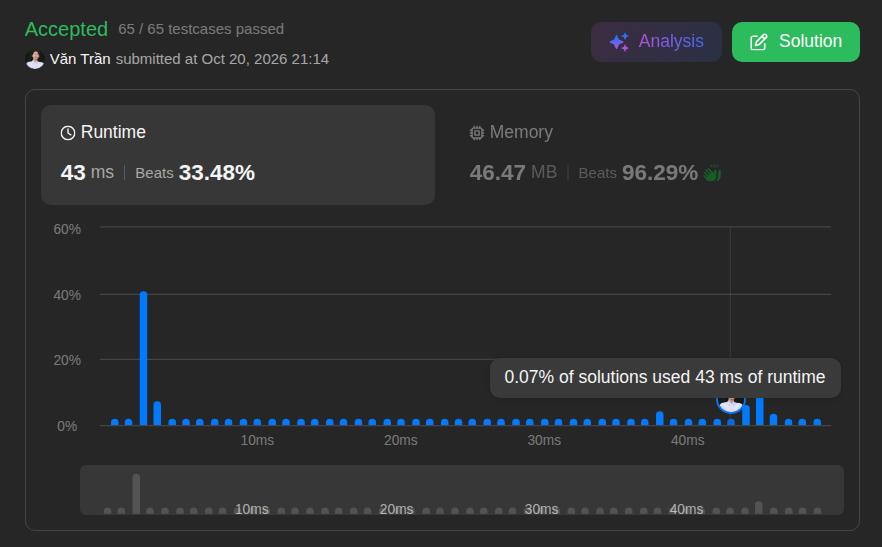
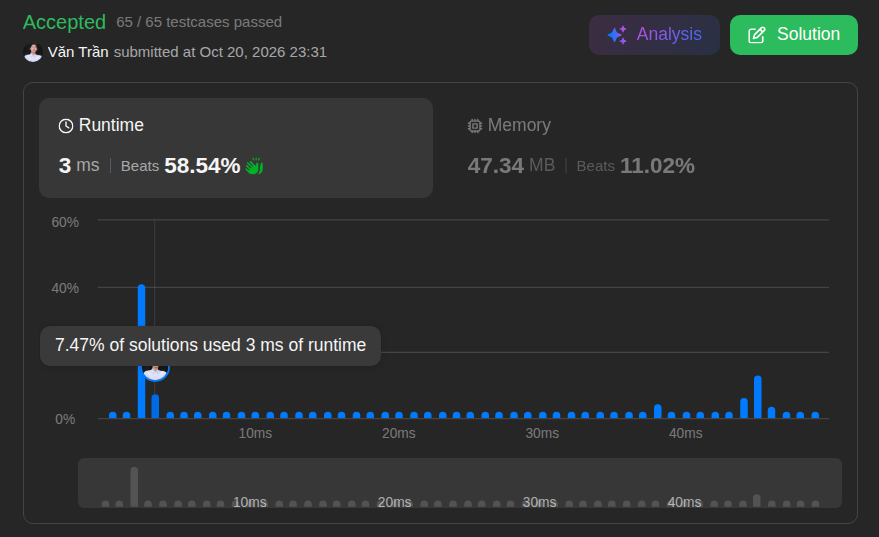

# 1. Two Sum

**Difficulty:** Easy · **Topics:** Array, Hash Table · **Language:** Java

## Problem

Given an integer array `nums` and an integer `target`, return the indices of the two numbers whose sum equals `target`.

Each input has exactly one solution, and the same element cannot be used twice. The indices may be returned in any order.

### Examples

| `nums` | `target` | Output |
| --- | ---: | --- |
| `[2, 7, 11, 15]` | `9` | `[0, 1]` |
| `[3, 2, 4]` | `6` | `[1, 2]` |
| `[3, 3]` | `6` | `[0, 1]` |

### Constraints

- `2 <= nums.length <= 10^4`
- `-10^9 <= nums[i] <= 10^9`
- `-10^9 <= target <= 10^9`
- Exactly one valid answer exists.

> **Follow-up:** Can you solve it in less than `O(n²)` time?

---

## Approach 1: Brute Force

Source: [`BruteForce.java`](./BruteForce.java)

Check every unique pair of indices. Return the pair as soon as its values sum to `target`.

| Time | Space | LeetCode runtime | LeetCode memory |
| :---: | :---: | :---: | :---: |
| `O(n²)` | `O(1)` | 43 ms | 46.47 MB |

This is simple, but it becomes slow for large inputs because it may inspect nearly every pair.



---

## Approach 2: Hash Map

Source: [`HashMapSolution.java`](./HashMapSolution.java)

As the array is traversed, store each previously seen number and its index in a `HashMap`. For each current number, calculate the required complement:

```java
int complement = target - nums[i];
```

If that complement is already in the map, the stored index and the current index form the answer. Otherwise, save the current number for a later element to match.

| Time | Space | LeetCode runtime | LeetCode memory |
| :---: | :---: | :---: | :---: |
| `O(n)` | `O(n)` | 3 ms | 47.34 MB |

The map uses additional memory, but it reduces the search to one pass and satisfies the follow-up requirement.



---

## Comparison

| Approach | Time | Space | Best use case |
| --- | :---: | :---: | --- |
| Brute Force | `O(n²)` | `O(1)` | Minimal extra memory; small inputs |
| Hash Map | `O(n)` | `O(n)` | Preferred solution for this problem |
