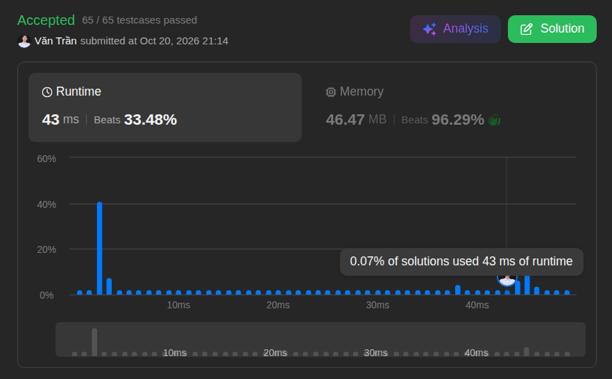
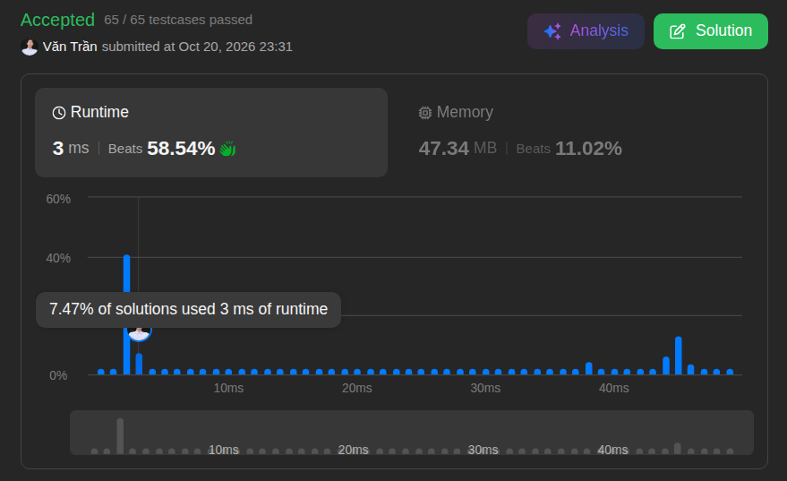

# 1. Two Sum

**Difficulty:** Easy · **Topic:** Array, Hash Table · **Language:** Java

## Problem

Given an array of integers `nums` and an integer `target`, return the indices of the two numbers such that they add up to `target`.

You may assume that each input has exactly one solution, and you may not use the same element twice. You can return the answer in any order.

### Examples

**Example 1**

```
Input:  nums = [2,7,11,15], target = 9
Output: [0,1]
```

Explanation: `nums[0] + nums[1] = 2 + 7 = 9`, which equals the target, so `[0, 1]` is returned.

**Example 2**

```
Input:  nums = [3,2,4], target = 6
Output: [1,2]
```

Explanation: `nums[1] + nums[2] = 2 + 4 = 6`, which equals the target, so `[1, 2]` is returned.

**Example 3**

```
Input:  nums = [3,3], target = 6
Output: [0,1]
```

Explanation: `nums[0] + nums[1] = 3 + 3 = 6`, which equals the target, so `[0, 1]` is returned.

### Constraints

- `2 <= nums.length <= 10^4`
- `-10^9 <= nums[i] <= 10^9`
- `-10^9 <= target <= 10^9`
- Only one valid answer exists.

**Follow-up:** Can you come up with an algorithm that is less than O(n²) time complexity?

---

## Approach 1: Brute Force

[`BruteForce.java`](./BruteForce.java)

**Idea**

- Use two nested `for` loops to iterate through the array and calculate the sum of every pair of numbers.
- If a pair sums to `target`, return the indices of those two numbers.

**Complexity**

| | Complexity | LeetCode result |
| --- | :---: | :---: |
| Time | O(n²) | 43 ms |
| Space | O(1) | 46.47 MB |

**Disadvantage**

It takes more time because the array is traversed with two nested loops. With an array of one million elements, this approach becomes extremely inefficient.



---

## Approach 2: Hash Map

[`HashMapSolution.java`](./HashMapSolution.java)

**Idea**

- Initialize a `HashMap` that stores each array element as a key and its index as the value.
- Iterate through the array with a single `for` loop. For each element, compute the complement: `complement = target - nums[i]`.
- If the complement already exists as a key in the map, return the complement's index and the current index.
- Otherwise, put the current element and its index into the map.

**Complexity**

| | Complexity | LeetCode result |
| --- | :---: | :---: |
| Time | O(n) | 3 ms |
| Space | O(n) | 47.34 MB |

**Disadvantage**

The trade-off is extra memory: the map is used to improve execution speed.



---

## Comparison

| Approach | Time | Space | Runtime | Memory |
| --- | :---: | :---: | :---: | :---: |
| Brute Force | O(n²) | O(1) | 43 ms | 46.47 MB |
| Hash Map | O(n) | O(n) | 3 ms | 47.34 MB |

The hash map approach trades a small amount of extra memory for a large gain in speed, which answers the follow-up question (less than O(n²)).