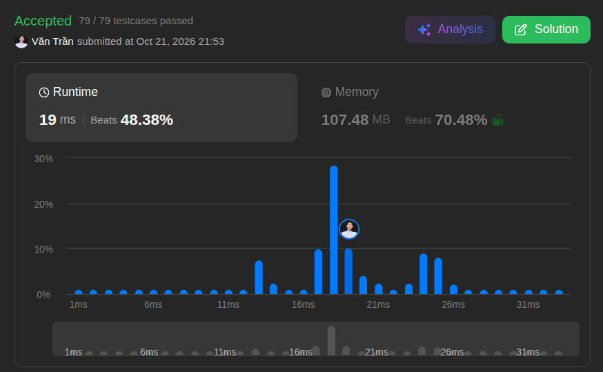

# 217. Contains Duplicate

**Difficulty:** Easy · **Topics:** Array, Hash Table · **Language:** Java

## Problem

Given an integer array `nums`, return `true` if any value occurs at least twice in the array. Otherwise, return `false` when every value is distinct.

### Examples

| `nums` | Output | Explanation |
| --- | :---: | --- |
| `[1, 2, 3, 1]` | `true` | `1` appears at indices `0` and `3`. |
| `[1, 2, 3, 4]` | `false` | Every value appears once. |
| `[1, 1, 1, 3, 3, 4, 3, 2, 4, 2]` | `true` | Several values occur more than once. |

### Constraints

- `1 <= nums.length <= 10^5`
- `-10^9 <= nums[i] <= 10^9`

---

## Approach: Hash Set

Source: [`HashSetSolution.java`](./HashSetSolution.java)

Use a `HashSet` to record values encountered while traversing `nums`.

1. For each value, try to add it to the set.
2. If the value is already present, it is a duplicate, so return `true` immediately.
3. If the traversal finishes, every value was unique; return `false`.

The solution can stop at the first duplicate, so it does not have to scan the remainder of the array in that case.

| Time | Space | LeetCode runtime | LeetCode memory |
| :---: | :---: | :---: | :---: |
| `O(n)` | `O(n)` | 19 ms | 107.48 MB |

The set gives fast membership checks, with the trade-off of using memory proportional to the number of distinct values.

## Key Takeaway

When the task is to detect whether a value has appeared before, a `HashSet` makes the check efficient: each lookup and insertion is `O(1)` on average.
