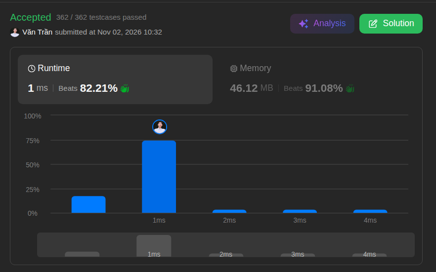

# 26. Remove Duplicates from Sorted Array

**Difficulty:** Easy · **Topics:** Array, Two Pointers · **Language:** Java

## Problem

Given an integer array `nums` sorted in non-decreasing order, remove the duplicates in-place so that each unique element appears only once. Preserve the relative order of the elements and return the number of unique elements, `k`.

The first `k` elements of `nums` must contain the unique values in sorted order. The values after index `k - 1` can be ignored.

### Examples

| `nums` | Output | Result |
| --- | ---: | --- |
| `[1, 1, 2]` | `2` | `[1, 2, _]` |
| `[0, 0, 1, 1, 1, 2, 2, 3, 3, 4]` | `5` | `[0, 1, 2, 3, 4, _, _, _, _, _]` |

### Constraints

- `1 <= nums.length <= 3 * 10^4`
- `-100 <= nums[i] <= 100`
- `nums` is sorted in non-decreasing order.

---

## Approach: Two Pointers

Source: [`TwoPointsSolution.java`](./TwoPointsSolution.java)

Use one pointer to scan the array and another to track where the next unique value should be written. Since the array is sorted, a value is unique when it differs from the previous value.

1. Keep the first element and set the write position to index `1`.
2. Scan from the second element. When the current value differs from the previous one, write it at the next write position and advance that position.
3. Return the write position; it is the number of unique values.

The scan and writes happen in place, so the algorithm uses constant extra space.

| Time | Space | LeetCode runtime | LeetCode memory |
| :---: | :---: | :---: | :---: |
| `O(n)` | `O(1)` | 1 ms | 46.12 MB |

## Key Takeaway

For a sorted array, duplicates are adjacent. A read pointer can find each new value while a write pointer compacts the unique values into the front of the same array.
