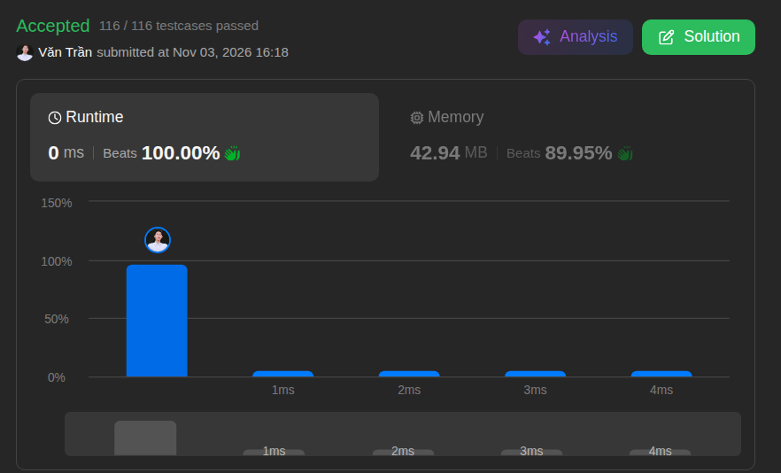

# 27. Remove Element

**Difficulty:** Easy · **Topics:** Array, Two Pointers · **Language:** Java

## Problem

Given an integer array `nums` and an integer `val`, remove all occurrences of `val` in-place. The relative order of the remaining elements may be changed. Return the number of elements that are not equal to `val`, `k`.

The first `k` elements of `nums` must contain the values that are not equal to `val`. The values after index `k - 1` can be ignored.

### Examples

| `nums` | `val` | Output | Result |
| --- | ---: | ---: | --- |
| `[3, 2, 2, 3]` | `3` | `2` | `[2, 2, _, _]` |
| `[0, 1, 2, 2, 3, 0, 4, 2]` | `2` | `5` | `[0, 1, 3, 0, 4, _, _, _]` |

### Constraints

- `0 <= nums.length <= 100`
- `0 <= nums[i] <= 50`
- `0 <= val <= 100`

---

## Approach: Two Pointers

Source: [`TwoPointsSolution.java`](./TwoPointsSolution.java)

Use one pointer to scan the array and another to track where the next value that is not equal to `val` should be written.

1. Start the write position at index `0`.
2. Scan every element. When the current value is not `val`, write it at the next write position and advance that position.
3. Return the write position; it is the number of elements that remain.

The solution compacts the remaining values in place and preserves their relative order. It uses constant extra space.

| Time | Space | LeetCode runtime | LeetCode memory |
| :---: | :---: | :---: | :---: |
| `O(n)` | `O(1)` | 0 ms | 42.94 MB |

## Key Takeaway

When removing values in place, a read pointer can scan the array while a write pointer compacts the values to keep into its front.
