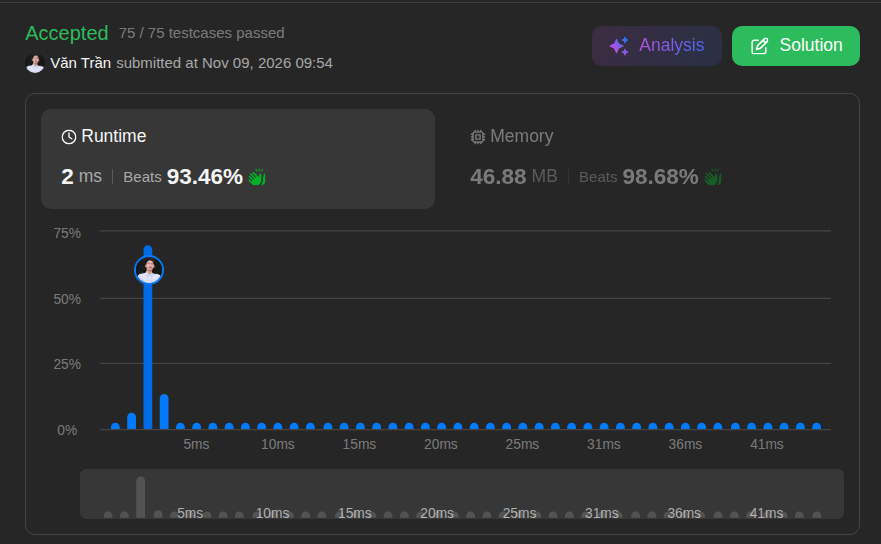
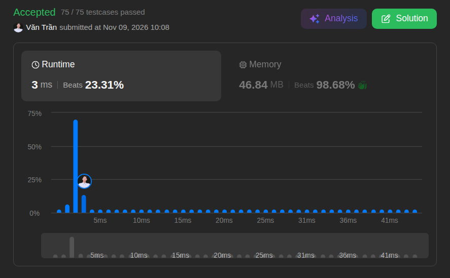

# 283. Move Zeroes

**Difficulty:** Easy · **Topics:** Array, Two Pointers · **Language:** Java

## Problem

Move all zeroes in an integer array `nums` to the end while preserving the relative order of the non-zero elements. Modify the array in place.

### Examples

| `nums` | Result |
| --- | --- |
| `[0, 1, 0, 3, 12]` | `[1, 3, 12, 0, 0]` |
| `[0]` | `[0]` |

### Constraints

- `1 <= nums.length <= 10^4`
- `-2^31 <= nums[i] <= 2^31 - 1`

---

## Approach 1: Overwrite, Then Fill with Zeroes

Source: [`ForWhileSolution.java`](./ForWhileSolution.java)

Use a read pointer to scan the array and a write pointer to track where the next non-zero value belongs.

1. Copy each non-zero value to the write position, then advance the write pointer.
2. Fill every remaining position with zero.

This keeps the non-zero values in order and uses constant extra space. The approach also avoids swapping: each non-zero value is written once, and the remaining positions are filled with zeroes.

| Time | Space | LeetCode runtime | LeetCode memory |
| :---: | :---: | :---: | :---: |
| `O(n)` | `O(1)` | 2 ms | 46.88 MB |

## Approach 2: Swap Non-Zero Values Forward

Source: [`SwapSolution.java`](./SwapSolution.java)

Use the same read and write pointers. When a non-zero value is found, swap it with the value at the write position, then advance the write pointer. This moves non-zero values forward while pushing zeroes toward the end.

The swap version also runs in `O(n)` time and uses `O(1)` extra space. However, it performs two array assignments for every non-zero value, in addition to the temporary variable assignment. Even when the array contains no zeroes and the pointers are at the same position, the current implementation still performs the self-swap.

| Time | Space | LeetCode runtime | LeetCode memory |
| :---: | :---: | :---: | :---: |
| `O(n)` | `O(1)` | 3 ms | 46.84 MB |

## Key Takeaway

Both approaches modify the input array in place, so neither preserves the original array. For this problem, when the input can be modified and only the final arrangement matters, overwriting is a good fit: it avoids the extra work of swapping and can reduce array writes. The recorded LeetCode runs show 2 ms for overwriting and 3 ms for swapping, but runtime measurements can vary between submissions and should not be treated as a guarantee.

In other situations, use swaps when values at their current positions must be preserved while they are being rearranged, or when the problem specifically calls for moving values without overwriting their source. If the original input itself must remain unchanged, neither in-place approach is suitable; make a copy instead.
